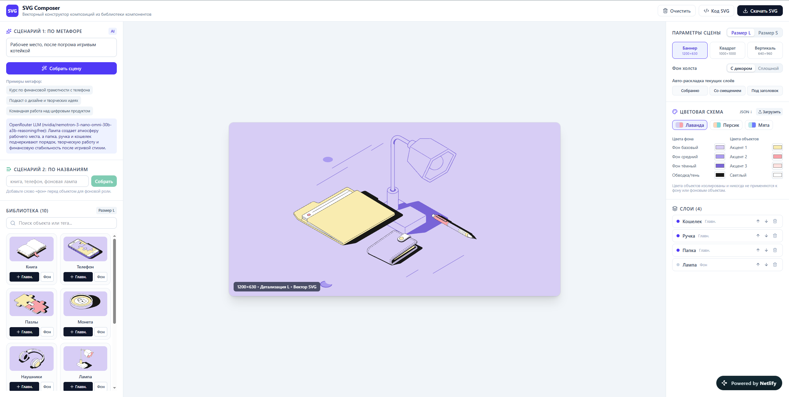
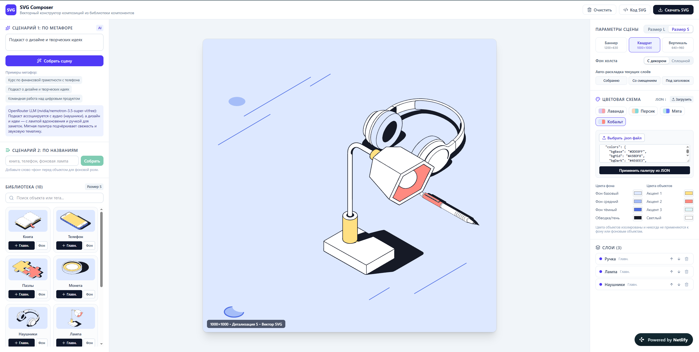

# SVG Composer

> **Живое демо:** [https://svg-composer.netlify.app/](https://svg-composer.netlify.app/)





Интерактивный веб-сервис и AI-ассистент для автоматической и ручной сборки векторных иллюстративных композиций из дизайн-системы компонентов с динамической перекраской палитр и экспортом в редактируемый SVG.

---

## Основные возможности

- **Библиотека компонентов в двух уровнях детализации (`L` / `S`):**
  - 10 объектов в 2 ролях (**Главный** — цветной с контуром и тенью, **Фоновый** — монохромный в тонах фона) и 2 масштабах детализации (`40` векторных шаблонов + оригинальный декор фона).
  - Мгновенное переключение `L ↔ S` с компенсацией `viewBox` — композиция меняет степень детализации под размер носителя, не нарушая взаимных пропорций элементов.
  - Поиск по названиям и смысловым тегам.
- **Умная генерация сцен:**
  - **По метафоре или заголовку:** подбор объектов, ролей (`Главный` / `Фоновый`), цветовой схемы и композиционной раскладки через серверную функцию `/api/compose` (OpenRouter LLM) с автоматическим фолбэком на встроенный локальный семантический движок (работает даже без сети и ключей).
  - **По списку компонентов:** быстрая сборка сцены из текстового перечисления (например: `книга, телефон, фоновая лампа`).
- **Векторный редактор и управление сценой:**
  - Интерактивный `<svg>`-холст (`drag & drop`, поворот, дублирование, удаление, переключение роли объекта, управление порядком слоёв).
  - 3 формата кадра (`Баннер 1200×630`, `Квадрат 1000×1000`, `Вертикаль 640×960`) и 3 композиционных пресета (`Собранно`, `Со смещением`, `Под заголовок`).
  - Фиксация взаимных пропорций элементов в рамках правил дизайн-системы.
- **Система палитр с изоляцией ролей:**
  - 3 встроенные цветовые схемы (`Лаванда`, `Персик`, `Мята`), live-редактор цветов, экспорт и импорт кастомных палитр в JSON.
  - Строгое разделение слоёв: фоновые оттенки доступны в объектах, но акцентные цвета главных объектов изолированы и никогда не применяются к фону или фоновым элементам.
- **Чистый векторный экспорт:**
  - Просмотр XML-кода и скачивание готового `.svg` с реальными HEX-цветами и `<clipPath>` по формату кадра — без растеризации и с сохранением редактируемой структуры групп в Figma / Illustrator.

---

## Архитектура: хранение, извлечение и переиспользование SVG

1. **Извлечение и токенизация (`scripts/build-library.mjs`):**
   - Исходные SVG из Figma в `raw-svg/` очищаются от служебных артефактов и приводятся к единому формату.
   - Извлекаются нативные `viewBox` (варианты `S` имеют масштаб `0.5×` относительно `L`) и внутреннее векторное дерево.
   - Конкретные цвета макета (`#181817`, `white`, `#D7CDF5`, `#AA9BF0`, `#7864D7`, `#F9ECB0`, `#F9A3AA`, `#FFE3E1`) заменяются на семантические токены (`{{ink}}`, `{{obj_light}}`, `{{bg_base}}`, `{{bg_mid}}`, `{{bg_dark}}`, `{{obj_1}}`, `{{obj_2}}`, `{{obj_3}}`).
2. **Хранение (`src/data/library.ts`, `src/data/palettes.ts`, `src/data/formats.ts`):**
   - Нормализованные шаблоны компилируются в типизированный TypeScript-модуль с метаданными и тегами, что обеспечивает мгновенный рендер и полностью автономную работу статики на Netlify.
3. **Переиспользование и перекраска (`src/utils/svgCompiler.ts`):**
   - При рендере на холсте и при экспорте `colorizeSvgBody()` подставляет актуальные `#HEX` выбранной палитры прямо в атрибуты векторных элементов (вместо CSS-переменных, которые не поддерживаются частью графических редакторов при импорте).
   - Для фоновых объектов (`role === "bg"`) акцентные токены принудительно маппятся только в фоновую часть палитры.
   - `getEffectiveScale()` выравнивает масштаб между `L` и `S`, сохраняя пропорции всех объектов относительно друг друга.
4. **AI-оркестрация (`src/utils/aiComposer.ts`):**
   - Языковая модель не генерирует сырую графику и произвольные координаты: она возвращает валидируемый через `sanitizePlan()` JSON-план (`items`, `role`, `paletteId`, `layoutPreset`), после чего объекты размещаются по выверенным композиционным слотам.

---

## AI-инструменты, использованные при разработке

- **LLM-ассистент (Google Gemini):** проектирование архитектуры токенизации SVG, написание скрипта нормализации исходников, разработка React/TypeScript-интерфейса, настройка JSON-контракта для LLM и отладка типизации (`verbatimModuleSyntax`).
- **Серверная AI-интеграция (`netlify/functions/compose.mjs`):** прокси к OpenRouter (`openrouter/free`) без утечки API-ключа в клиент и без браузерных CORS-ограничений + локальный семантический фолбэк в `src/utils/aiComposer.ts`.

---

## Примеры собранных композиций

Готовые векторные `.svg`-композиции сохранены в папке [`examples/`](./examples):
- `01-banner-fintech.svg` — баннер `1200×630` (детализация `L`, палитра «Лаванда»)
- `02-square-podcast.svg` — квадрат `1000×1000` (детализация `L`, палитра «Мята»)
- `03-vertical-compact.svg` — вертикаль `640×960` (детализация `S`, палитра «Персик»)

---

## Локальный запуск

```bash
npm install
npm run dev
```

Пересборка библиотеки SVG из исходников `raw-svg/`:
```bash
node scripts/build-library.mjs
```

Продакшн-сборка:
```bash
npm run build
```
